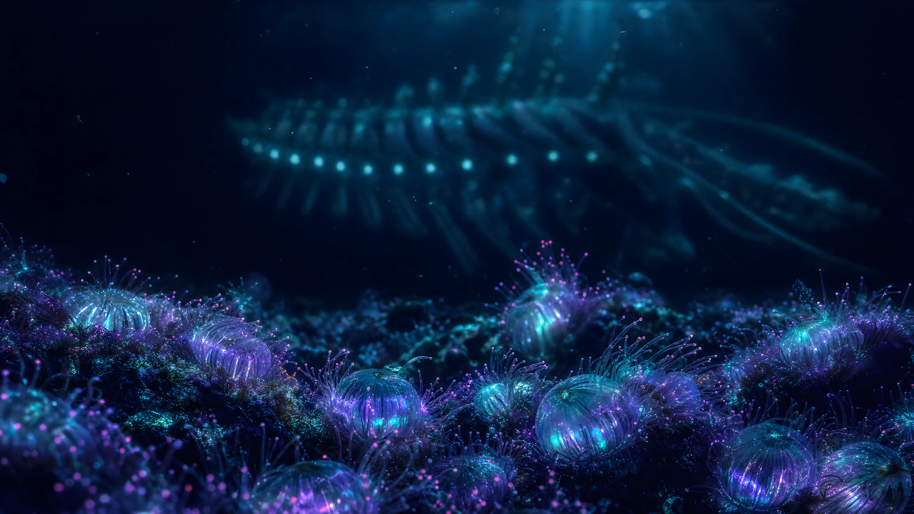

# Abyssal

A deep-sea theme for [Omarchy](https://omarchy.org/): near-black ocean blues lit by bioluminescent cyan, with coral, plankton and lantern-fish accents.



## Install

```bash
omarchy theme install https://github.com/vadim-su/omarchy-abyssal-theme
```

## Palette

| Role | Color | | Role | Color |
|---|---|---|---|---|
| Background | `#050d17` | | Foreground | `#c8e6ee` |
| Accent / cyan | `#3de8c8` | | Selection | `#123247` |
| Red | `#ff6b8b` | | Bright red | `#ff9db2` |
| Green | `#5ef2a0` | | Bright green | `#9af7c4` |
| Yellow | `#f2d478` | | Bright yellow | `#f8e6a8` |
| Blue | `#4aa8ff` | | Bright blue | `#8cc8ff` |
| Magenta | `#b48cff` | | Bright magenta | `#d2b8ff` |
| Orange | `#ff9e6b` | | Muted | `#3f6478` |

All app configs (terminals, Hyprland, Neovim, btop, browser, etc.) are generated by Omarchy from `colors.toml`. Icons use `Yaru-prussiangreen-dark`.

## Backgrounds

22 wallpapers of an imagined abyss: trenches, vents, alien reefs, glass siphonophores, lantern swarms and the creatures that hunt there. Cycle them with `omarchy theme bg next`.

## Files

```
colors.toml     # palette, the single source of truth
icons.theme     # GTK icon theme
preview.webp    # screenshot for the theme picker
backgrounds/    # wallpapers
```
